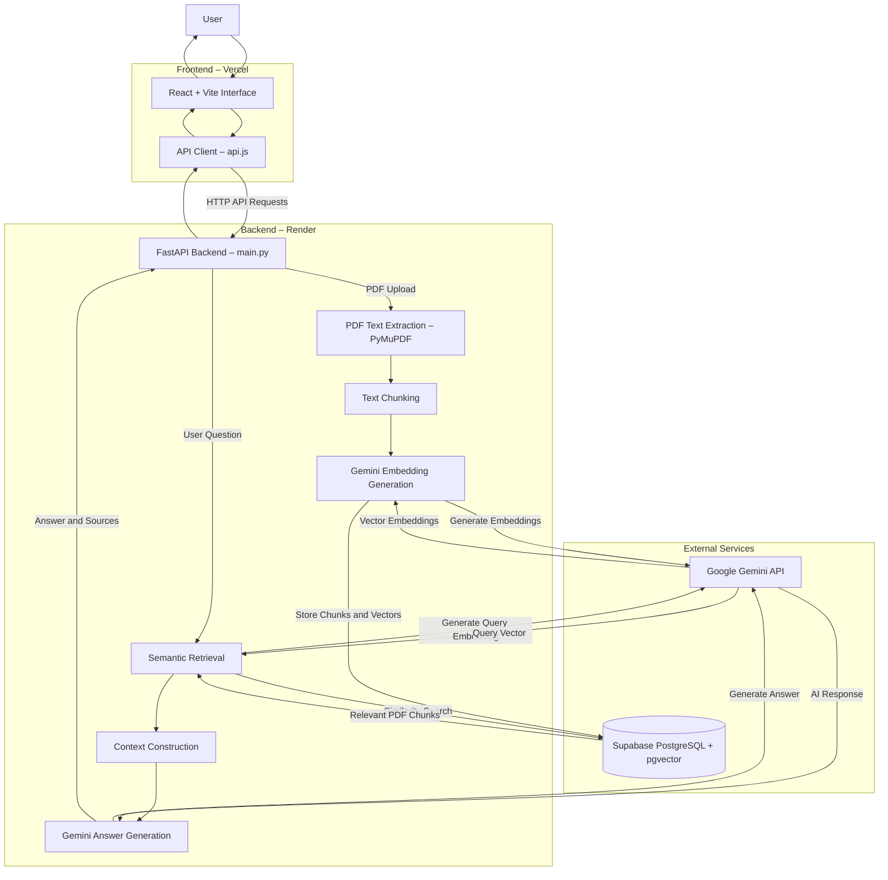

# FindPDF – System Architecture

## 1. Architecture Overview

FindPDF is an AI-powered PDF question-answering application built using a Retrieval-Augmented Generation (RAG) architecture.

The system allows users to upload PDF documents, extract and process their content, generate vector embeddings, and ask natural-language questions. Relevant document passages are retrieved from Supabase using semantic similarity and passed to Google Gemini to generate context-aware answers.

## 2. System Architecture Diagram

## 3. Main Components

| Component | Technology | Responsibility |
|---|---|---|
| Frontend | React + Vite | User interface and document interaction |
| API Client | JavaScript | Communicates with the backend |
| Backend | FastAPI | Handles uploads, processing and chat requests |
| PDF Processing | PyMuPDF | Extracts text from PDF files |
| Embedding Model | Gemini Embedding | Converts text into vector representations |
| Vector Database | Supabase + pgvector | Stores and retrieves document embeddings |
| LLM | Google Gemini | Generates answers using retrieved context |
| Frontend Hosting | Vercel | Hosts the web application |
| Backend Hosting | Render | Hosts the FastAPI service |

## 4. Core Processing Workflows

### A. PDF Upload and Indexing

1. The user uploads one or more PDF documents.
2. The React frontend sends the files to the FastAPI backend.
3. PyMuPDF extracts text from the PDF documents.
4. Extracted text is divided into smaller chunks.
5. Gemini generates vector embeddings for the chunks.
6. Document chunks, metadata and embeddings are stored in Supabase.

### B. Question Answering and Retrieval

1. The user submits a question through the chat interface.
2. FastAPI receives the question.
3. Gemini generates an embedding for the question.
4. Supabase performs semantic similarity search using pgvector.
5. Relevant passages are retrieved from the indexed documents.
6. The retrieved passages are used to construct the context for the LLM.
7. Google Gemini generates a context-aware response.
8. The backend returns the answer and source information to the frontend.

### C. Multi-PDF Retrieval

FindPDF supports querying multiple uploaded PDF documents within the same application. Its retrieval process uses document-aware ranking to identify relevant passages across the stored documents.

## 5. Deployment Architecture

- **Frontend:** Vercel
- **Backend:** Render
- **Database and Vector Search:** Supabase
- **AI Services:** Google Gemini API

The frontend communicates with the backend through HTTP API requests. The backend integrates with Supabase and Google Gemini to process documents and generate responses.

## 6. Architecture Summary

FindPDF combines document processing, vector embeddings, semantic retrieval and large language models into a complete RAG-based PDF question-answering system. Its modular architecture separates the frontend, backend, database and AI services, making the application easier to maintain and extend.