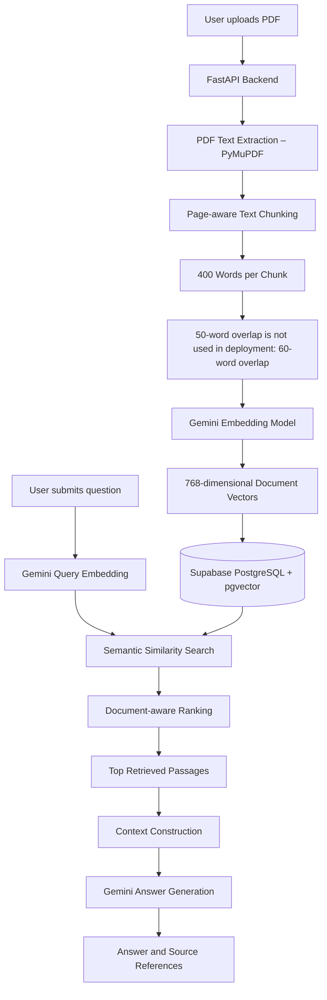

# FindPDF – RAG Pipeline Documentation

## 1. Overview

FindPDF uses Retrieval-Augmented Generation (RAG) to answer natural-language questions about uploaded PDF documents.

Instead of relying only on the language model's internal knowledge, the system retrieves relevant passages from uploaded documents and provides them as context to Google Gemini.

The application combines PDF text extraction, text chunking, vector embeddings, semantic search and large language model generation.

## 2. Technologies Used

| Component | Technology |
|---|---|
| PDF Text Extraction | PyMuPDF |
| Text Chunking | Custom Python implementation |
| Embedding Model | Gemini Embedding (`gemini-embedding-001`) |
| Embedding Dimensions | 768 |
| Vector Database | Supabase PostgreSQL + pgvector |
| Similarity Search | Cosine Distance |
| Language Model | Gemini (`gemini-3.6-flash`) |
| Backend | FastAPI |
| Frontend | React + Vite |

## 3. RAG Pipeline Architecture

## 4. PDF Text Extraction

The backend uses PyMuPDF to extract selectable text from uploaded PDF files.

The extraction process:

1. Opens the PDF from its uploaded byte content.
2. Iterates through the document pages.
3. Extracts text using the `get_text("text")` method.
4. Retains the original page number.
5. Ignores pages that contain no extracted text.

The application currently supports text-based PDFs. Scanned PDFs without selectable text require OCR, which is not currently implemented.

## 5. Text Chunking

Extracted text is divided into smaller overlapping chunks to make semantic retrieval more effective.

### Chunking configuration

| Parameter | Value |
|---|---:|
| Chunk Size | 400 words |
| Chunk Overlap | 60 words |
| Processing Unit | Individual PDF pages |

### Chunking process

1. Extracted page text is split into individual words.
2. A maximum of 400 words is selected for each chunk.
3. The next chunk starts 340 words after the previous chunk's starting position.
4. This preserves 60 words of overlap between consecutive chunks on the same page.
5. Each chunk retains its original page number.

Chunks do not cross PDF page boundaries.

## 6. Embedding Generation

FindPDF uses Google's `gemini-embedding-001` model to convert document chunks into numerical vector representations.

### Embedding configuration

| Parameter | Value |
|---|---|
| Model | `gemini-embedding-001` |
| Output Dimensions | 768 |
| Batch Size | 50 |
| Document Task Type | `RETRIEVAL_DOCUMENT` |
| Query Task Type | `RETRIEVAL_QUERY` |

Document chunks are converted into embeddings in batches of up to 50.

Each generated vector is validated to ensure that it contains exactly 768 dimensions.

The same embedding model is used to generate query embeddings when users submit questions.

## 7. Supabase Vector Storage

FindPDF uses Supabase PostgreSQL with the pgvector extension to store and retrieve document embeddings.

The application maintains two primary tables:

### Documents table

Stores document metadata, including:

- Document ID
- Document name
- File size
- Page count
- Creation timestamp

### Chunks table

Stores the extracted and embedded document passages, including:

- Chunk ID
- Document ID
- Page number
- Extracted text content
- 768-dimensional embedding vector

Document metadata and corresponding chunks are stored in Supabase for persistent retrieval.

## 8. Semantic Similarity Retrieval

When a user asks a question, the backend generates a query embedding using the Gemini embedding model.

The query vector is passed to the Supabase SQL function:

`match_pdf_chunks`

The function uses pgvector's cosine-distance operator:

`<=>`

Similarity is calculated as:

**Similarity = 1 - Cosine Distance**

### Retrieval process

1. Generate a 768-dimensional query embedding.
2. Apply the selected document IDs as an optional filter.
3. Calculate cosine distance between the query vector and stored chunk vectors.
4. Rank chunks independently within each document.
5. Retain up to five candidate chunks per document.
6. Sort the retained candidates by similarity.
7. Apply the global result limit.

### Retrieval configuration

| Parameter | Value |
|---|---:|
| Candidates per document | 5 |
| Backend retrieval limit | 5 |
| Maximum SQL result limit | 20 |
| Similarity method | Cosine distance |

The deployed FastAPI backend currently calls the SQL function with `match_count=5`. Therefore, at most five passages are returned for each normal chat request.

The SQL function supports a configurable global limit of up to 20, but the deployed backend currently requests five.

## 9. Multi-PDF Retrieval

FindPDF supports querying multiple uploaded PDF documents within the same application.

The retrieval function uses:

`ROW_NUMBER() OVER (PARTITION BY c.document_id ...)`

This ranks chunks independently for each document.

The `filter_document_ids` parameter allows retrieval to be restricted to selected documents.

This design supports:

- Searching across multiple uploaded PDFs.
- Selecting specific documents for a question.
- Ranking passages separately within each document.
- Comparing information retrieved from different documents.
- Returning source document names and page numbers.

The per-document ranking creates up to five candidates per document before the final global result limit is applied. It does not guarantee that every selected document will appear in the final results.

## 10. Context Construction and Answer Generation

After retrieval, FastAPI constructs a context from the relevant passages.

Each passage includes:

- Passage number
- Source document name
- Original page number
- Extracted content

The constructed context and user's question are passed to Google Gemini.

### Generation configuration

| Parameter | Value |
|---|---|
| Model | `gemini-3.6-flash` |
| Temperature | 0.2 |
| Maximum Output Tokens | 2500 |

The system prompt instructs Gemini to:

1. Answer using only the supplied PDF passages.
2. Avoid inventing facts, quotations or page numbers.
3. Cite source document names and page numbers for important claims.
4. Clearly state when the retrieved evidence does not answer the question.
5. Distinguish evidence from different documents when making comparisons.

The generated answer is returned to the frontend together with source information.

## 11. Source References

FindPDF returns source information alongside the generated answer.

Each source includes:

- Document ID
- Document name
- Page number
- Text excerpt
- Similarity score

The excerpt returned by the backend is limited to 700 characters.

This helps users identify where the retrieved information originated.

## 12. Reliability and Error Handling

The backend includes additional mechanisms to improve reliability:

- Gemini temporary service errors are retried with exponential backoff.
- Gemini quota errors are handled separately.
- Upload and chat requests have per-IP rate limits.
- Invalid, empty and oversized PDF files are rejected.
- Unexpected server errors are handled without exposing internal exception details to API clients.

The configured request limits are:

| Operation | Limit |
|---|---:|
| Chat requests | 10 per minute per IP |
| PDF uploads | 5 per minute per IP |
| Maximum PDF size | 25 MB |

## 13. Local FAISS Experiment

The repository also contains a separate local embedding experiment in `embeddings.py`.

That implementation uses:

- Sentence Transformers (`all-MiniLM-L6-v2`)
- 384-dimensional embeddings
- FAISS `IndexFlatIP`
- Normalized embeddings
- Local storage in `faiss.index` and `chunks.json`

This is separate from the deployed application's Gemini Embedding and Supabase pgvector retrieval pipeline.

## 14. Conclusion

FindPDF combines document extraction, overlapping text chunking, vector embedding generation, semantic retrieval and large language model generation into a complete RAG-based PDF question-answering application.

Its document-aware retrieval mechanism supports questions across multiple uploaded PDFs while retaining source document and page information to help users trace the generated answers.