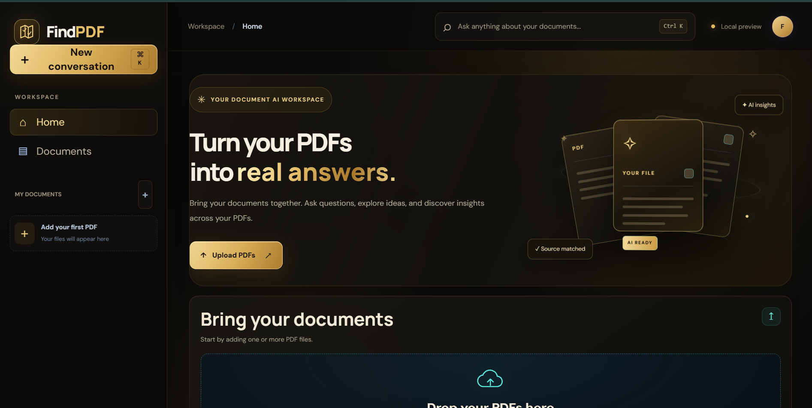
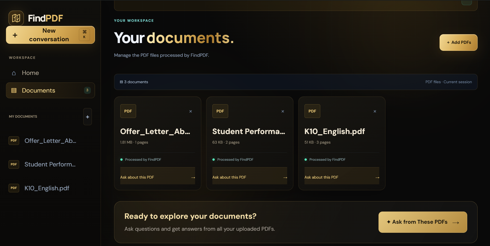
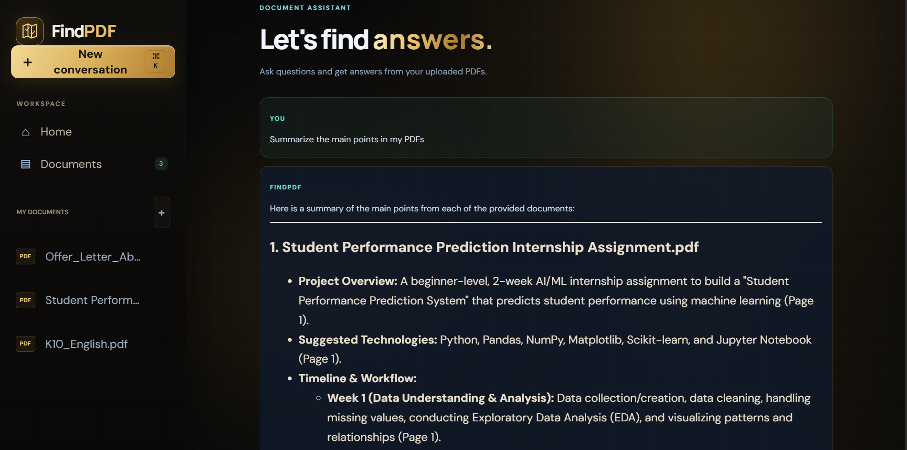
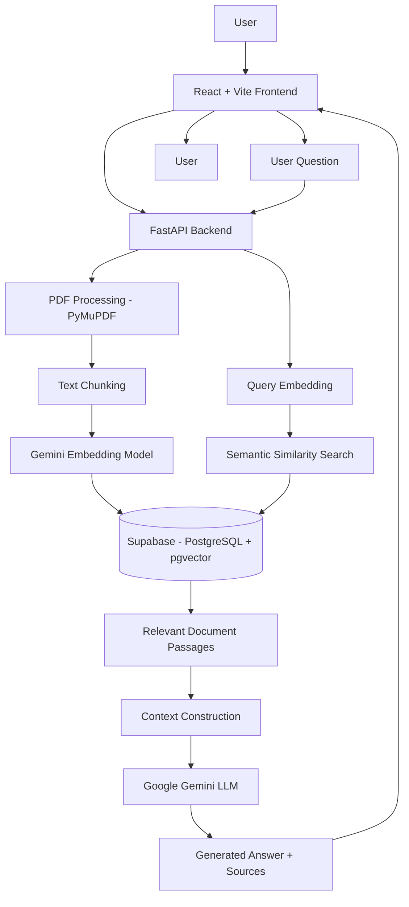

# FindPDF — Chat with Your PDFs

**An AI-powered multi-document question-answering application built using Retrieval-Augmented Generation (RAG).**

FindPDF allows users to upload PDF documents, ask questions in natural language, retrieve relevant information from multiple documents, and receive AI-generated answers grounded in the document content.

**Live Application:** https://find-pdf.vercel.app/  
**GitHub Repository:** https://github.com/abdulbasithpctr-123/FindPDF

---

## Project Overview

FindPDF is a full-stack AI application that makes information retrieval from PDF documents easier through semantic search and Large Language Models (LLMs).

Instead of manually searching through lengthy documents, users can upload PDFs and interact with their content through a conversational interface.

The application uses a Retrieval-Augmented Generation (RAG) pipeline to extract document text, divide it into smaller chunks, generate vector embeddings, retrieve semantically relevant passages, and generate contextual answers using Google Gemini.

FindPDF also supports querying multiple uploaded PDFs, enabling users to retrieve and compare information across selected documents.

## Key Features

- **Multiple PDF Uploads:** Upload and manage multiple PDF documents.
- **Conversational PDF Chat:** Ask questions about uploaded documents using natural language.
- **RAG-Based Question Answering:** Generate answers grounded in retrieved document passages.
- **Semantic Search:** Retrieve relevant content using vector similarity.
- **Multi-Document Retrieval:** Search across selected PDFs and retrieve relevant passages from different documents.
- **Source References:** Include document names and page numbers in answers and source information.
- **Persistent Storage:** Store document metadata and embedded text chunks using Supabase.
- **Cloud Deployment:** Access the application through a publicly deployed web interface.

## Technology Stack

| Component | Technologies |
|---|---|
| Frontend | React, Vite, JavaScript |
| Backend | Python, FastAPI |
| LLM | Google Gemini |
| Embedding Model | Gemini Embedding 001 |
| Vector Database | Supabase, PostgreSQL, pgvector |
| PDF Processing | PyMuPDF |
| Data Validation | Pydantic |
| Deployment | Vercel, Render |

## Application Screenshots

### FindPDF Dashboard



### Multiple PDF Uploads



### AI-Powered Document Conversation



## System Architecture

FindPDF follows a client-server architecture with a Retrieval-Augmented Generation pipeline.



## RAG Pipeline

The application follows these main processing stages.

### 1. PDF Upload and Text Extraction

Users upload PDF documents through the React frontend. The FastAPI backend receives the files and extracts selectable text and page information using PyMuPDF.

### 2. Text Chunking

Extracted text is divided into smaller overlapping chunks to improve retrieval.

Current configuration:

- Chunk size: 400 words
- Chunk overlap: 60 words

Each chunk retains its original document ID and page number.

### 3. Embedding Generation

The Gemini Embedding 001 model converts document chunks into numerical vector representations.

- Embedding model: `gemini-embedding-001`
- Embedding dimensions: 768
- Document embedding task: `RETRIEVAL_DOCUMENT`
- Query embedding task: `RETRIEVAL_QUERY`

### 4. Vector Storage

Document metadata and embedded text chunks are stored in Supabase using PostgreSQL and pgvector.

This enables persistent storage and similarity-based retrieval.

### 5. Semantic Retrieval

When a user submits a question:

1. The question is converted into an embedding.
2. Supabase performs vector similarity search.
3. The retrieval function ranks passages within each selected document.
4. Relevant passages are sorted by similarity and returned to the backend.

The retrieval configuration controls the number of passages returned.

### 6. Context Construction and Answer Generation

The retrieved passages are assembled into a context containing document names, page numbers and extracted content.

The context and user question are passed to Google Gemini, which generates a response grounded in the retrieved PDF content.

### 7. Source Information

The backend returns the generated answer together with source information, including document names, page numbers and relevant excerpts.

## Multi-Document Retrieval

One of FindPDF's important capabilities is retrieving information across multiple uploaded documents.

The application uses document-specific ranking in its Supabase retrieval function.

Rather than ranking every passage without considering document identity, the SQL function ranks chunks within each document and then combines the results by similarity.

This allows relevant passages from different selected PDFs to participate in the retrieval process, subject to the overall retrieval limit.

Users can use this capability to ask questions involving multiple documents and explore similarities, differences and shared topics.

## Project Structure

```text
FindPDF/
│
└── FindPDF-Web/
    │
    ├── backend/
    │   ├── main.py
    │   └── requirements.txt
    │
    ├── src/
    │   ├── api.js
    │   ├── App.jsx
    │   └── ...
    │
    ├── public/
    ├── package.json
    └── ...
```

## Local Installation and Setup

### Prerequisites

- Python 3.10+
- Node.js and npm
- Google Gemini API key
- Supabase project with PostgreSQL and pgvector configured

### 1. Clone the Repository

```bash
git clone https://github.com/abdulbasithpctr-123/FindPDF.git
cd FindPDF/FindPDF-Web
```

### 2. Configure the Backend

Navigate to the backend directory:

```bash
cd backend
```

Create a virtual environment:

```bash
python -m venv .venv
```

Activate it on Windows:

```bash
.venv\Scripts\activate
```

Install dependencies:

```bash
pip install -r requirements.txt
```

Create a `.env` file in the project root and configure:

```env
GEMINI_API_KEY=your_gemini_api_key
SUPABASE_URL=your_supabase_project_url
SUPABASE_SERVICE_ROLE_KEY=your_supabase_service_role_key
FRONTEND_URL=http://localhost:5173
```

Never commit your `.env` file or expose your service-role key.

Start the backend:

```bash
uvicorn main:app --reload
```

Backend API:

`http://127.0.0.1:8000`

API documentation:

`http://127.0.0.1:8000/docs`

### 3. Configure the Frontend

Open another terminal and navigate to the frontend directory:

```bash
cd FindPDF-Web
```

Install dependencies:

```bash
npm install
```

Configure the API base URL in `src/api.js`:

```javascript
const API_BASE_URL = "http://127.0.0.1:8000/api";
```

Start the development server:

```bash
npm run dev
```

Open:

`http://localhost:5173`

## Environment Variables

| Variable | Purpose |
|---|---|
| `GEMINI_API_KEY` | Authenticates Google Gemini API requests |
| `SUPABASE_URL` | Supabase project URL |
| `SUPABASE_SERVICE_ROLE_KEY` | Backend database access |
| `FRONTEND_URL` | Frontend origin allowed by backend CORS |

Keep all credentials private and store production secrets in the backend hosting environment.

## Deployment

FindPDF is deployed using separate frontend and backend hosting services.

| Service | Platform |
|---|---|
| React frontend | Vercel |
| FastAPI backend | Render |
| Database and vector storage | Supabase |
| AI processing | Google Gemini |

**Live application:** https://find-pdf.vercel.app/

## Future Enhancements

- OCR support for scanned PDF documents.
- Streaming AI responses.
- Conversation history and session management.
- Advanced document-level comparison.
- Improved retrieval evaluation and relevance ranking.
- Support for additional document formats.
- User authentication and document-level access control.

## Author

**Abdul Basith**

AI & Machine Learning | Python | Generative AI | RAG | NLP | Deep Learning

GitHub: https://github.com/abdulbasithpctr-123

---

*FindPDF demonstrates the practical integration of document processing, semantic retrieval, vector databases, LLMs and full-stack application development.*